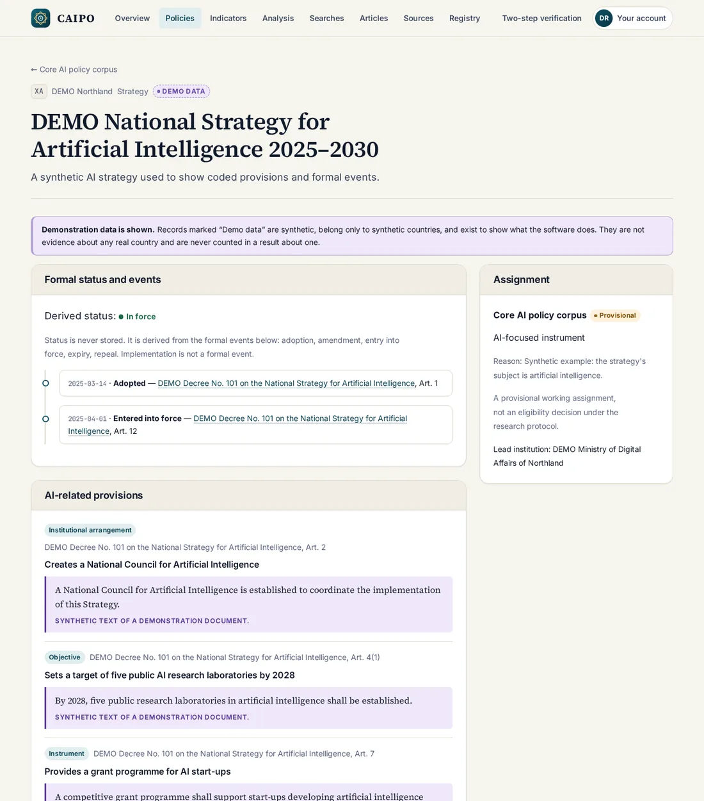
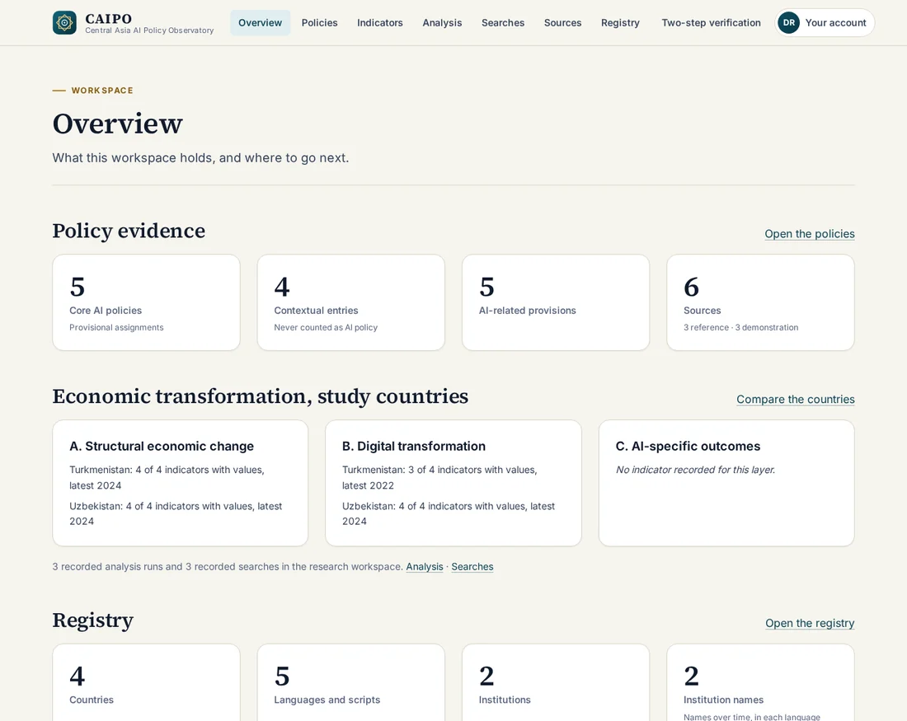
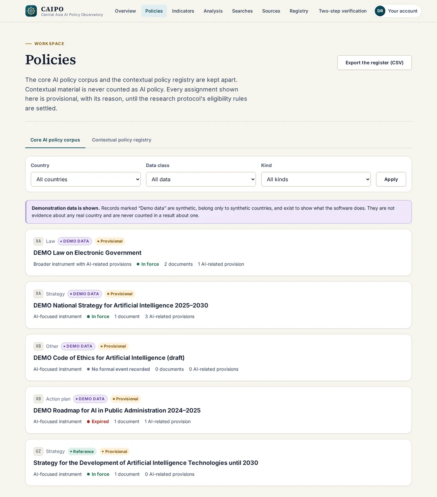
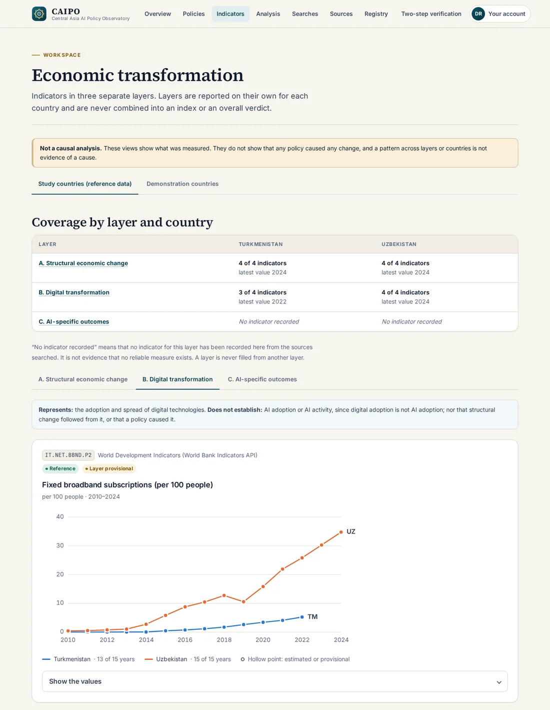
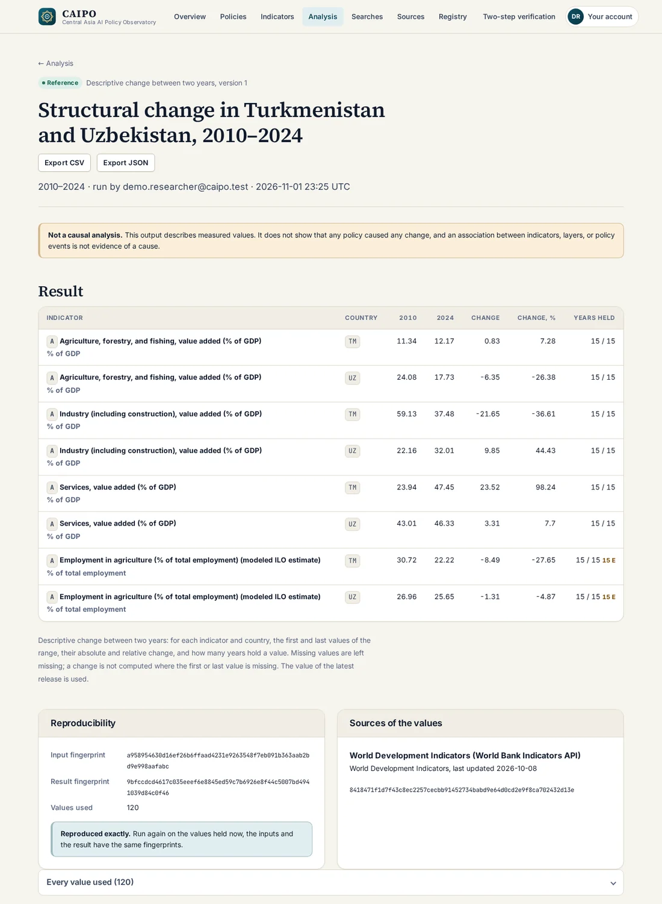
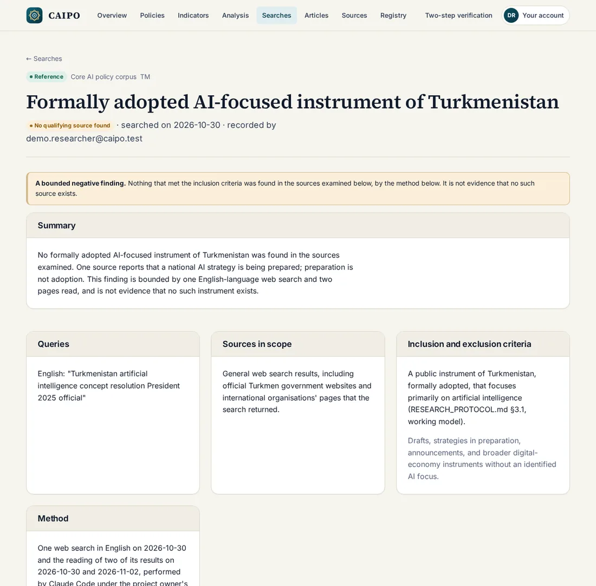
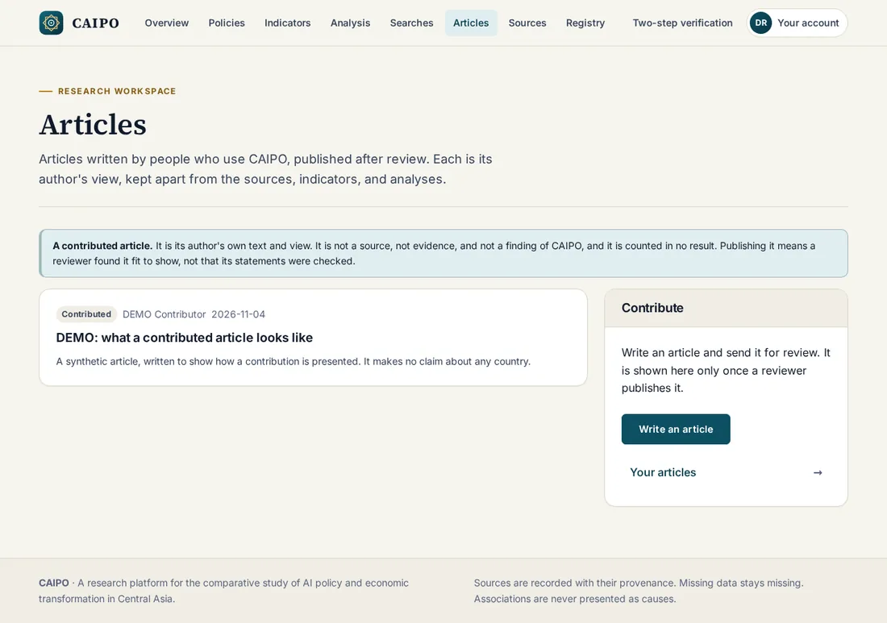
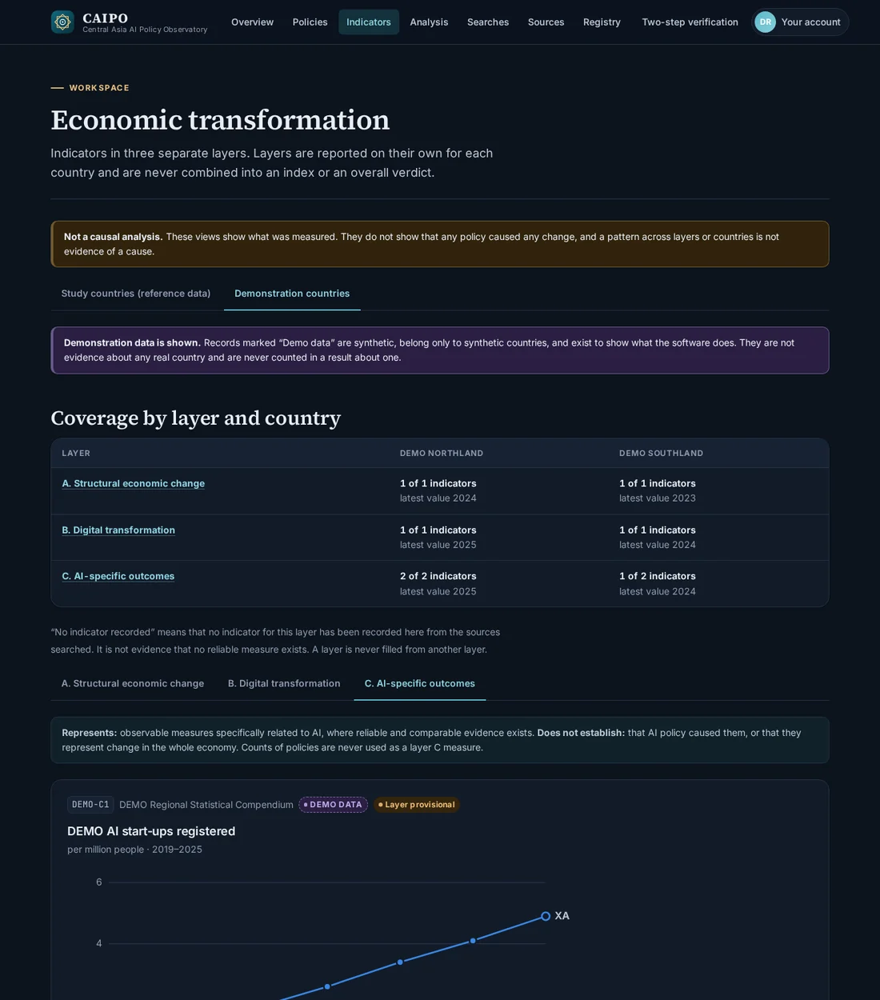
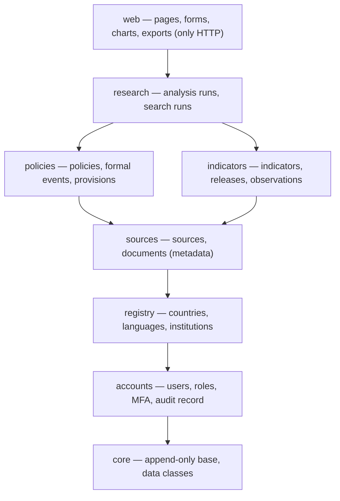

# CAIPO — Central Asia AI Policy Observatory

Research platform for the study **"AI Policy and Economic Transformation in Central Asia: A Comparative Analysis of Turkmenistan and Uzbekistan"**.

CAIPO records public policy sources with their provenance, keeps the **core AI policy corpus** apart from broader **contextual policy**, compares countries on economic indicators in **three separate layers** with every gap in the data left visible, and runs **reproducible, descriptive analyses** whose inputs and results are fingerprinted. It is designed so that further Central Asian countries can be added as data, without changing the software.



## Status

**A working demonstrator, built on a research platform whose research gates are still closed.**

- The platform foundation (Phase 1) is complete: accounts, roles and permissions, sign-in with TOTP two-step verification, account provisioning, registration on the site for the Reader role ([ADR-0021](docs/adr/0021-registration-for-the-reader-role.md)), and recovery, the registry of countries, languages, and institutions, the general audit record, health endpoints, and structured logging.
- Anyone can register a Reader account ([ADR-0021](docs/adr/0021-registration-for-the-reader-role.md)) and contribute **articles**, which a reviewer publishes or declines; an article is labelled as its author's view under CC BY 4.0 and is never evidence ([ADR-0022](docs/adr/0022-contributed-articles.md)).
- On top of it, the **demonstrator track** ([ADR-0020](docs/adr/0020-demonstrator-track.md)) adds working sources, policies, indicators, analysis runs, search runs, and exports, built ahead of the research gates in a reduced, clearly labelled form.
- The architecture gate stays **NOT READY for Phase 2 and later** ([specification §10](docs/PROJECT_SPECIFICATION.md#10-architecture-gate)). The research decisions it waits for — the domain boundary, the study period, the indicator selection, the rights policy, the ethics review — are open, and nothing in the demonstrator closes them.
- Progress, Day by Day, is recorded in [docs/EXECUTION_TRACKER.md](docs/EXECUTION_TRACKER.md), the only progress record.

## How CAIPO is built

CAIPO is an independent project with one owner, who is also its researcher and operator. The owner chose the study and its questions. The owner sets the rules the project works by, accepts or rejects every architecture decision record, makes the research decisions, and merges each pull request by hand.

The software and most of the documentation are written by an AI coding agent, Claude Code (Anthropic). The agent works under the binding rules in [CLAUDE.md](CLAUDE.md), in units of work recorded one by one in [docs/EXECUTION_TRACKER.md](docs/EXECUTION_TRACKER.md). It may not accept a decision record, close a research question, or merge a change; those stay with the owner. Since 2026-10-03 every change has been a pull request, checked by the required CI jobs.

At a glance, on 2026-11-13:

- 23 [architecture decision records](docs/adr/README.md), of which three are still proposals and are not built on.
- More than 5,000 automated tests, run with lint, strict type checking, import-layer contracts, a dependency audit, and a secret scan on every pull request.
- Append-only provenance enforced by database triggers, not only by application code.
- Every page reachable by link checked with axe-core at three widths in both themes, against the WCAG 2.2 AA target.

## What you can do in it

| | |
|---|---|
|  | **Overview.** What the workspace holds: core and contextual policies, provisions, sources, indicator coverage per layer and country. |
|  | **Policies.** The core AI policy corpus and the contextual policy registry on separate tabs, with filters and a "what is recorded, by country" table. Every assignment is provisional and carries its reason. |
|  | **Economic transformation.** Indicators in layers A (structural change), B (digital transformation), and C (AI-specific outcomes), never combined. Real World Bank values for Turkmenistan and Uzbekistan, with every gap shown as a gap; layer C is reported as having no indicator rather than dropped. An indicator's page shows the formal events of the core AI policies of the same countries above its values, on the same years, in a panel of their own. |
|  | **Analysis.** Descriptive change between two years, with every input value and its release, SHA-256 fingerprints of inputs and result, a one-click reproducibility check, and CSV and JSON exports carrying their provenance. |
|  | **Searches.** How the absence of a source is recorded: as the bounded outcome of a documented search, never as a document. |
|  | **Articles.** Anyone can [register](docs/images/register.webp) a Reader account and contribute an article. A Reviewer or Administrator, signed in with a second factor, publishes it or declines it with a reason the author sees. Every [article](docs/images/article.webp) is labelled as its author's view, not evidence, and is published under CC BY 4.0. |
|  | **Design.** A bespoke design system with light and dark themes, self-hosted fonts that cover Turkmen, Uzbek, and Russian, and layouts down to phone width ([phone](docs/images/phone.webp)). No violation of the WCAG 2.2 A/AA rules found by axe-core on 17 pages in either theme, nor on the registration, article, and indicator pages added since. |

## Real data and demonstration data are never mixed

Every record carries a **data class**, held by a database check:

- **Reference data** — real public sources: metadata of legal documents (for example Uzbekistan's resolution RP-358 of 14.10.2024 on the AI strategy to 2030, from lex.uz), and eight World Bank indicators for Turkmenistan and Uzbekistan, 2010–2024 (CC BY 4.0), committed with their file hashes. **No text of a legal document is held**, because its rights are not decided, and the database refuses quoted text on a reference record.
- **Demonstration data** — synthetic records of two synthetic countries, *DEMO Northland* (XA) and *DEMO Southland* (XB), which show every feature. They can belong only to ISO 3166 user-assigned country codes, are labelled on every page and in every export, and are never counted in a result about a real country.

What is implemented, what is simulated, and what is future work is set out in [docs/DEMO.md](docs/DEMO.md#what-is-real-what-is-simulated-what-is-future).

## Principles

1. **Every source is traceable.** Publisher, address, access date, terms, permitted use, and the hash of what was obtained. See [docs/DATA_MODEL.md](docs/DATA_MODEL.md).
2. **Missing data stays missing.** No value is interpolated, rounded on storage, or carried from one layer to another.
3. **Status is derived, never stored.** A policy's formal status comes from its formal events only; implementation is not a formal event.
4. **History is append-only.** Formal events, dataset releases, observations, analysis runs, search runs, and audit events refuse UPDATE and DELETE at the database.
5. **No causal claims.** Every comparison and export carries the non-causation notice. See [docs/LIMITATIONS.md](docs/LIMITATIONS.md).
6. **External content is untrusted.** See [SECURITY.md](SECURITY.md) and [ADR-0009](docs/adr/0009-untrusted-content-handling.md).

## Architecture

A Django modular monolith on PostgreSQL, with server-rendered templates and no JavaScript build step. Apps form layers, and an app imports only from layers below it; five import contracts check this in CI.



Services write and selectors read. Every write to the registry and the research records checks its permission, validates, and records an audit event in the same transaction; account changes keep their own event records. Details: [docs/ARCHITECTURE.md](docs/ARCHITECTURE.md).

## Getting started

Requires Docker with Compose, `uv`, and Git ([docs/DEVELOPMENT.md](docs/DEVELOPMENT.md)).

```sh
uv sync
cp .env.example .env          # then set the two passwords, DJANGO_SECRET_KEY, and TOTP_ENCRYPTION_KEY (docs/DEVELOPMENT.md)
docker compose up -d --wait
uv run --env-file .env python manage.py migrate
uv run --env-file .env python manage.py seed_demo --password "<choose one>"   # demonstration environment, development only
uv run --env-file .env python manage.py runserver                            # then open http://127.0.0.1:8000/
```

Sign in as `demo.researcher@caipo.test` (can add records and run analyses) or `demo.reader@caipo.test` (reads only), with the password you chose, or create your own Reader account at `/register/`. No email is sent in development: the message with the activation link is written to `data/outbox/`. A 5–10 minute walk-through is in **[docs/DEMO.md](docs/DEMO.md)**.

To run the checks:

```sh
uv run --env-file .env pytest                 # about 5,000 tests, about 12 minutes
uv run ruff check . && uv run ruff format --check . && uv run mypy && uv run lint-imports
```

The Compose file is for local development only, not for deployment.

## Documentation map

| Document | Purpose |
|---|---|
| [docs/DEMO.md](docs/DEMO.md) | Demonstration script, and what is real, simulated, and future |
| [docs/PROJECT_SPECIFICATION.md](docs/PROJECT_SPECIFICATION.md) | Scope, users, requirements, phases, architecture gate |
| [docs/RESEARCH_PROTOCOL.md](docs/RESEARCH_PROTOCOL.md) | Research questions, source rules, epistemic taxonomy, review workflow |
| [docs/ARCHITECTURE.md](docs/ARCHITECTURE.md) | System design, security boundaries, failure modes, deployment |
| [docs/DATA_MODEL.md](docs/DATA_MODEL.md) | Domain model and integrity rules, including the demonstrator's forms (§7a) |
| [docs/AI_ARCHITECTURE.md](docs/AI_ARCHITECTURE.md) | Retrieval, verification, synthesis, evaluation (designed; not built) |
| [docs/REPRODUCIBILITY.md](docs/REPRODUCIBILITY.md) | What is pinned, recorded, and replayable |
| [docs/LIMITATIONS.md](docs/LIMITATIONS.md) | What this research and system cannot support |
| [docs/INTERFACE_TEXT.md](docs/INTERFACE_TEXT.md) | How pages and messages are worded: no causal claims, no absence presented as proof |
| [docs/adr/](docs/adr/README.md) | Architecture decision records |
| [docs/PRODUCT_EXCELLENCE_BLUEPRINT.md](docs/PRODUCT_EXCELLENCE_BLUEPRINT.md) | Product proposal: user journeys, design direction, roadmap, and open owner decisions. Not authorisation to implement |
| [docs/EXECUTION_TRACKER.md](docs/EXECUTION_TRACKER.md) | Progress, execution Days, pending owner decisions. A progress record only: the documents above govern |
| [docs/DEVELOPMENT.md](docs/DEVELOPMENT.md) | Local development environment |
| [docs/RIGHTS_AND_LICENSING.md](docs/RIGHTS_AND_LICENSING.md) | Software license, and the separate rights in documents and data |
| [CLAUDE.md](CLAUDE.md) | Binding rules for AI implementation agents |
| [CONTRIBUTING.md](CONTRIBUTING.md) | Workflow, tooling, Definition of Done |
| [SECURITY.md](SECURITY.md) | Threat model and security requirements |

## License

CAIPO's original software is released under the [MIT License](LICENSE).

The MIT License covers the software only. It does not cover government documents, research papers, datasets, logos, or any other third-party material that CAIPO stores or processes, nor text extracted from them. Those remain subject to their own rights holders' terms. World Bank data is used under CC BY 4.0 with the World Bank's terms: *The World Bank: World Development Indicators*; the World Bank does not endorse this project. The fonts are under the SIL Open Font License (`caipo/web/static/web/fonts/`). The licence for research data created by the project is not yet decided. See [docs/RIGHTS_AND_LICENSING.md](docs/RIGHTS_AND_LICENSING.md).
